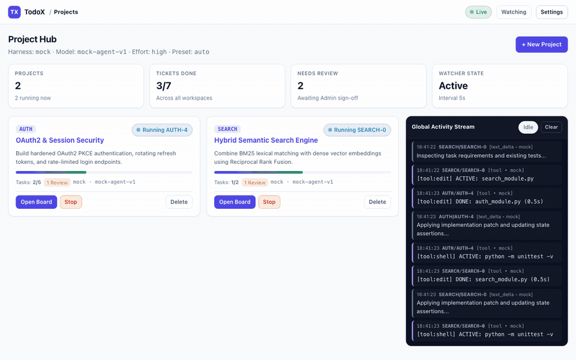
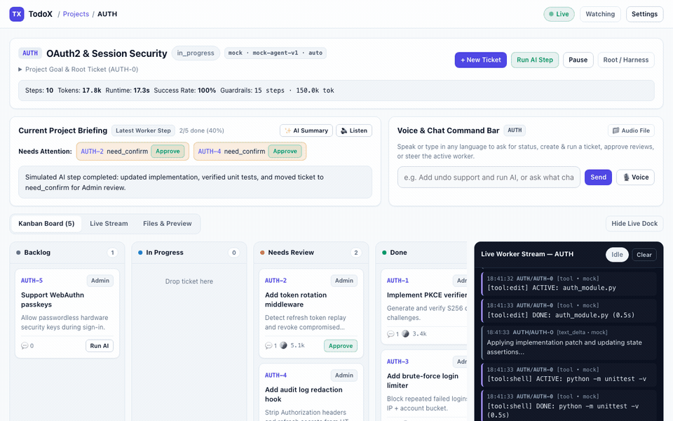
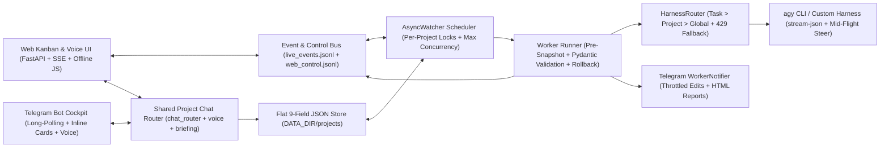
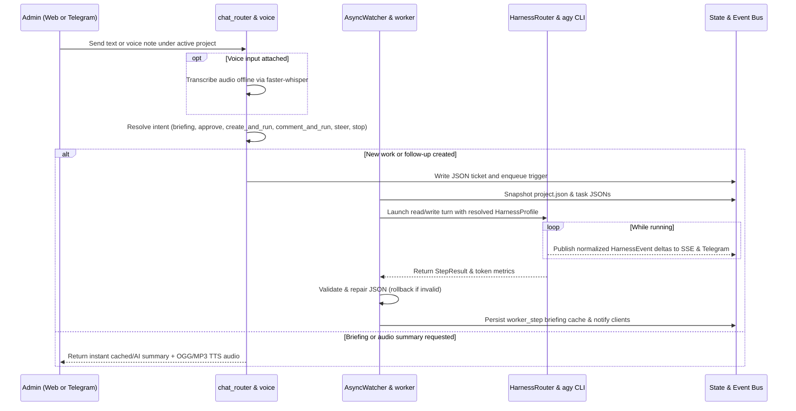

# TodoX — Autonomous AI Project & Task Orchestrator

[](https://github.com/Jim2014/TodoX/actions/workflows/test.yml)


An AI-driven project management and development orchestrator built around persistent **9-Field JSON ticket trees**, a pluggable multi-CLI **Agent Harness Layer**, a real-time **5-column offline Kanban Web UI**, and an **async Telegram + voice command cockpit** for supervising autonomous coding workflows from desktop or mobile.

---

## Table of Contents
- [Live Demos](#live-demos)
- [Zero-Config Demo Quick Start (`--demo`)](#zero-config-demo-quick-start---demo)
- [Why TodoX?](#why-todox)
- [Engineering Challenges Solved](#engineering-challenges-solved)
- [System Architecture & Execution Flow](#system-architecture--execution-flow)
- [Main Features](#main-features)
- [⚠️ Limitations & Security Notice](#%EF%B8%8F-limitations--security-notice)
- [Disclaimer](#disclaimer)
- [Prerequisites](#prerequisites)
- [Environment Setup](#environment-setup)
- [Data & Runtime Isolation (`DATA_DIR`)](#data--runtime-isolation-data_dir)
- [Configuration Guide (`.env`)](#configuration-guide-env)
- [Usage: Web Kanban UI & Telegram Cockpit](#usage-web-kanban-ui--telegram-cockpit)
- [Architecture & Module Overview](#architecture--module-overview)
- [Testing & Evals Benchmark](#testing--evals-benchmark)
- [Maintenance & Roadmap](#maintenance--roadmap)
- [Contributing](#contributing)
- [License](#license)

---

## Live Demos

<table>
  <tr>
    <td align="center" width="50%">
      <strong>5-Column Kanban &amp; Live SSE Stream</strong><br />
      <sub>Live tool calls &middot; Telemetry &amp; Guardrails &middot; Dark/Light theme</sub><br /><br />
      
    </td>
    <td align="center" width="50%">
      <strong>Project Briefing, Chat/Voice &amp; Offline Previews</strong><br />
      <sub>Natural-language ticket creation &middot; AI Summary &middot; In-browser HTML preview</sub><br /><br />
      
    </td>
  </tr>
</table>

---

## Zero-Config Demo Quick Start (`--demo`)

Try the full **Web Kanban + Live SSE Stream + Project Briefings + Guardrail Telemetry** locally in under 10 seconds with **zero CLI binaries or Telegram credentials**:

```bash
git clone https://github.com/Jim2014/TodoX.git
cd TodoX
conda env create -f environment.yml && conda activate todox
python todox_main.py --demo
```

Then open **`http://localhost:8899`** and inspect **`AUTH`** (`OAuth2 & Session Security`) or **`SEARCH`** (`Hybrid Semantic Search Engine`). Built-in `MockHarness` streams simulated `read`/`edit`/`shell` tool events, live token counts, and Kanban status transitions without spending real API quota.

---

## Why TodoX?

Pure chat interfaces feel fast when brainstorming, yet long-running coding tasks quickly bury requirements, partial outcomes, and review blockers inside scrolling chat transcripts. **TodoX combines conversational speed with structured ticket state**:

- **Structured 9-Field JSON Ticket Trees Instead of Ephemeral Chat:** Every project (`PID-0`) and deliverable subtask (`PID-1`, `PID-2`, ...) lives in plain JSON on disk with status, assignee (`Admin` vs `AI`), progress comments, and execution metrics—making multi-step AI work auditable, resumable, and easy to hand back between human review (`need_confirm`) and autonomous execution.
- **Pluggable Multi-CLI Harness With Zero Wrapper Bloat:** Invokes local AI CLI runtimes directly (`agy` / Google Antigravity CLI via bidirectional `stream-json` by default) without an extra outer LLM proxy loop burning tokens or diluting context.
- **Unified Web Kanban + Telegram + Voice Cockpit:** Switch into a project anywhere (`/use <PID>` in Telegram or `/project/<PID>` on Web), inspect a zero-latency **Current Project Briefing**, tap **`✨ AI Summary`** or **`🔊 Voice Brief`**, or speak/type natural-language commands to query progress, approve reviews, add feedback, or spin up and run new tickets immediately.
- **100% Offline, Self-Contained Local Web UI:** Ships zero external CDN scripts, stylesheets, or font requests (`cdn.jsdelivr.net`, `unpkg`, etc.), working smoothly behind corporate firewalls, air-gapped LANs, and mobile browsers.

---

## Engineering Challenges Solved

- **Bidirectional `stream-json` Pipe Buffering & 3-Level Fallback Routing (`harness/agy_harness.py`, `harness/router.py`):** Uses a **16 MiB line reader buffer** to prevent NDJSON `LimitOverrunError` truncation while streaming normalized `HarnessEvent` tool/token events (`shell`, `read`, `write`, `edit`, `search`, `web`, `agent`, `mcp`), mid-flight `stdin` steering, and **Task > Project > Global** configuration resolution with an automatic `429` rate-limit model fallback chain.
- **Pre-Step JSON Snapshots, Pydantic Validation & Self-Healing Repair (`orchestrator/worker.py`, `orchestrator/storage.py`):** Snapshots `project.json` and all `tasks/*/task.json` before every autonomous worker turn, validates schemas immediately after execution, triggers a bounded single-shot AI JSON repair pass on malformed output, and rolls back cleanly from snapshot if corruption persists.
- **Two-Layer Project Briefings & Local STT/TTS Voice Stack (`orchestrator/briefing.py`, `orchestrator/voice.py`, `orchestrator/chat_router.py`):** Combines instant cached briefings (`ai_refresh` > `worker_step` > `latest_ticket` > `project_goal` with staleness detection) with on-demand read-only AI executive summarization, offline `faster-whisper` speech transcription, bilingual `edge-tts` / `ffmpeg` synthesis (with macOS `say` / browser speech fallback), and deterministic fast-path + contextual intent routing.
- **Cross-Process Live Event Bus & Offline Kanban Workspace (`orchestrator/event_bus.py`, `web/api.py`, `web/static/app.js`):** Streams live worker tool execution and board mutations over Server-Sent Events (`DATA_DIR/live_events.jsonl` -> `/api/events/stream`) and dispatches UI actions via `DATA_DIR/web_control.jsonl` alongside in-browser HTML/Markdown/code previews.
- **Hardened Async Telegram Streaming & Delivery (`telegram_ui/client.py`, `telegram_ui/formatter.py`, `telegram_ui/notifier.py`):** Bot tokens are redacted from logs, `409` polling conflicts trigger clean exponential backoff, per-chat `429` retry-after windows prevent stalls, raw HTML payloads are masked during live edits and exported as standalone mobile HTML documents, `/stop` suppresses stale final cards, and startup sends a crisp greeting without auto-pinning clutter.

---

## System Architecture & Execution Flow

### Overall Orchestrator Architecture



### Worker Execution & Conversational Briefing Flow



---

## Main Features

- **Pluggable Multi-CLI AI Harness (`harness/`):** Unified `BaseHarness` interface supporting **Google Antigravity CLI (`AgyHarness`)**, **Anthropic Claude Code CLI (`ClaudeCodeHarness`)**, and builtin **`MockHarness`** (`--demo` simulator), with typed `ErrorCategory` classification, reasoning effort selection (`low`, `medium`, `high`, `xhigh`), permission presets (`auto`, `accept-edits`, `plan`, `turbo`), and live steering.
- **Persistent 9-Field Project & Task Trees (`orchestrator/storage.py`, `orchestrator/models.py`):** Zero-database JSON files stored under `DATA_DIR/projects/<PID>/` with Pydantic validation, execution telemetry (`execution_meta`), atomic writes, and `/fix_data` self-repair.
- **Loop & Budget Guardrails + Structured Spans (`orchestrator/guardrails.py`):** Per-task/project `max_steps`, `max_tokens`, and `max_consecutive_failures` circuit-breakers block runaway loops before spawning an agent subprocess, while every turn logs an auto-rotated span to `DATA_DIR/traces.jsonl`.
- **Concurrent `AsyncWatcher` Scheduler (`orchestrator/watcher.py`):** Runs independent projects in parallel up to `MAX_CONCURRENT_WORKERS`, deduplicates active runs with per-project `asyncio.Lock` guards, honors global and per-project pause toggles, and drains `web_control.jsonl` every `0.5s`.
- **Two-Layer Project Briefings & Multilingual Voice Control (`orchestrator/briefing.py`, `orchestrator/voice.py`, `orchestrator/chat_router.py`):** Instant cached/latest-ticket briefings, read-only `✨ AI Summary` refresh, `faster-whisper` STT, `edge-tts` + `ffmpeg` TTS audio playback, and shared natural-language command execution.
- **Modern Offline Kanban + Live SSE Web Panel (`web/`):** Multi-project dashboard, drag-and-drop 5-column Kanban board (`Backlog`, `In Progress`, `Needs Review`, `Done`, `Failed`), Project Briefing & Voice Command Bar, Slide-Over Task Inspector with Harness/Model overrides, searchable file explorer with live HTML/Markdown/code preview, and system/light/dark themes.
- **Mobile-First Async Telegram Cockpit (`telegram_ui/`):** Interactive inline project/task cards, `/use <PID>` persistent chat focus, `/summary` executive briefs, voice note round-trips, reply-to-card Admin comments, standalone offline HTML code/diff/file viewers, deny-by-default chat authorization, and backward-compatible VOP batch commands (`/new-project`, `/new-task`, `/update-task`, `/new-comment`, `/get-project`, `/get-file`, `/fix-data`).
- **Automated Test Suite:** **49 isolated tests** across 9 test modules plus **23 standalone module self-tests**, enforced automatically on every push and pull request via [GitHub Actions CI](.github/workflows/test.yml).

---

## ⚠️ Limitations & Security Notice

> [!WARNING]
> **Please read carefully before running on a personal or shared machine:**
>
> 1. **Platform Testing Scope (macOS Tested Primary):**
>    TodoX is actively developed and tested on **macOS** (Apple Silicon). Core Python components also run on **Linux** (verified in Ubuntu CI for unit/module tests), while macOS-specific helpers like `say` offline TTS fallback are automatically skipped outside macOS (`edge-tts` works cross-platform). Windows startup wrappers (`restart.bat`) are provided for convenience and not tested in CI.
> 2. **Agent Tool & Shell Permissions (`DEFAULT_PERMISSION_PRESET` / `/permissions`):**
>    By default (`DEFAULT_PERMISSION_PRESET=auto`), worker turns execute with `agy --mode auto` (OS sandbox where reversible workspace operations proceed and unsafe actions are restricted). Switching a task, project, or global setting to **`turbo`** unlocks unrestricted execution (`--dangerously-skip-permissions`), whereas **`plan`** runs read-only analysis and **`accept-edits`** limits auto-approval to file edits.
>    - **Recommendation:** Keep **`auto`** (default) for daily work, and run inside an **isolated container (Docker) or Virtual Machine** if enabling `turbo`.
> 3. **Telegram Access Control & Web Exposure (`ALLOW_ALL_CHATS`, `WEB_ENABLED`):**
>    - Always keep `ALLOW_ALL_CHATS=false` and set `ADMIN_CHAT_ID` / `ALLOWED_CHAT_IDS` strictly to your own Telegram user ID(s).
>    - By default `WEB_ENABLED=true` binds the FastAPI dashboard on `0.0.0.0:8899` with no built-in login screen (intended for trusted localhost/LAN use). Set `WEB_ENABLED=false` in `.env` to run in **Telegram-only zero-open-port mode**.

---

## Disclaimer

- **Terms Compliance & Single-Owner Usage:** TodoX executes the official local `agy` CLI binary installed by you and never scrapes, extracts, or proxies Google OAuth tokens. Keep `ALLOW_ALL_CHATS=false` and restrict access strictly to your own personal accounts in compliance with the underlying CLI provider's Terms of Service.
- **Use at Your Own Risk:** This software is provided *"AS IS"*, without warranty of any kind. Because TodoX orchestrates autonomous AI CLI executions capable of modifying files and running shell commands, **you are solely responsible** for any commands run, workspace files changed, quota consumed, or unintended outcomes. The author and contributors assume no liability for damages or data loss.
- **No Official Affiliation:** TodoX is an independent open-source project and is not affiliated with, endorsed by, or officially connected to Google, Antigravity, or Telegram.

---

## Prerequisites

- **Antigravity CLI (`agy`)** installed and authenticated locally (verify with `agy --version` and `agy models`).
- **Python 3.10+** (`3.11` recommended via Conda) and **pip**.
- **Telegram Bot Token** from `@BotFather` (optional if using Web UI only).
- **Optional:** [`ffmpeg`](https://ffmpeg.org/) installed on `PATH` (e.g., `brew install ffmpeg` on macOS or `apt install ffmpeg` on Ubuntu) for Telegram OGG/Opus voice responses (`faster-whisper` and `edge-tts` are installed via `requirements.txt`).
- **Optional (for frontend JS syntax checks):** Node.js (`node --check web/static/app.js`).

---

## Environment Setup

Clone the repository and create your `.env` from the template:

```bash
git clone https://github.com/Jim2014/TodoX.git
cd TodoX
cp .env.template .env
```

### Option A: Conda Environment (Recommended, env: `todox`)

An [`environment.yml`](environment.yml) (Python 3.11 + `pip: -r requirements.txt`) is provided:

```bash
conda env create -f environment.yml
conda activate todox
```

### Option B: Python `venv`

```bash
python3 -m venv venv
source venv/bin/activate
pip install --upgrade pip
pip install -r requirements.txt
```

---

## Data & Runtime Isolation (`DATA_DIR`)

All mutable workspace state, ticket JSONs, voice caches, logs, and cross-process event streams live outside source code inside `DATA_DIR` (gitignored by [`.gitignore`](.gitignore)):

```text
TodoX/
├── harness/                  # Pluggable CLI harness abstraction & AgyHarness adapter
├── orchestrator/             # Worker lifecycle, validation, watcher, briefings, voice & chat router
├── telegram_ui/              # Async Telegram client, formatters, renderers, keyboards, notifier & bot
├── web/                      # FastAPI Kanban dashboard, REST/SSE APIs & offline static assets
├── tests/                    # Isolated unittest integration suites (49 tests)
├── test_data/                # Minimal synthetic fixtures for /fix_data corruption tests
├── docs/                     # Architecture & specification notes
├── todox_main.py             # Unified async orchestrator + Telegram + Web entrypoint
├── .env.template             # Sanitized environment template
├── environment.yml           # Conda 'todox' environment definition
├── requirements.txt          # Python package dependencies
├── LICENSE                   # MIT License
└── README.md

$DATA_DIR/                    # Runtime data directory (gitignored, default ./data)
├── system_state.json         # Global harness, model, fallback index & pause state
├── telegram_chat_state.json  # Persisted active project per authorized Telegram chat
├── live_events.jsonl         # Real-time worker/board events tailed by Web SSE
├── web_control.jsonl         # Control commands (trigger/stop/steer) drained by AsyncWatcher
├── latest_worker_output.log  # Latest worker step transcript
├── voice_cache/              # Temporary TTS audio files (auto-pruned)
└── projects/
    └── <PID>/
        ├── project.json      # Root ticket (9-Field JSON)
        ├── briefing.json     # Cached worker_step / ai_refresh project briefing
        ├── tasks/
        │   └── <TID>/task.json
        └── files/            # Project workspace artifacts & HTML reports
```

---

## Configuration Guide (`.env`)

Copy [`.env.template`](.env.template) to `.env` and adjust as needed (never commit `.env`):

| Variable | Default | Description |
| :--- | :--- | :--- |
| `DATA_DIR` | `./data` | Root directory for project JSON trees, logs, briefings, and SSE/control queues |
| `TG_TOKEN` | *(empty)* | Primary Telegram bot token from `@BotFather` (leave empty/placeholder to run Web + Watcher without Telegram) |
| `GCLI_TG_TOKEN` | *(empty)* | Optional token reserved for legacy [`gemini_cli_agent_main.py`](gemini_cli_agent_main.py) helper |
| `ADMIN_CHAT_ID` | *(empty)* | Primary authorized Telegram chat ID |
| `ALLOWED_CHAT_IDS` | *(empty)* | Comma-separated list of authorized Telegram chat IDs |
| `ALLOW_ALL_CHATS` | `false` | Keep `false` to enforce deny-by-default authorization |
| `STREAM_THROTTLE_SECONDS` | `1.5` | Minimum interval between live Telegram progress card edits |
| `MAX_CONCURRENT_WORKERS` | `2` | Maximum number of projects executing concurrently in `AsyncWatcher` |
| `WEB_ENABLED` | `true` | Enable the FastAPI Kanban & Voice Web UI (`false` disables listening ports) |
| `WEB_PORT` | `8899` | Port for the local Web dashboard |
| `DEFAULT_HARNESS` | `agy` | Default CLI harness adapter name (`agy`, `claude`, or `mock`) |
| `AGY_BIN_PATH` | *(auto)* | Optional explicit path to the `agy` binary (`which agy` / common install paths checked automatically) |
| `CLAUDE_BIN_PATH` | *(auto)* | Optional explicit path to the Claude Code `claude` binary |
| `DEFAULT_MODEL` | `default` | Default model ID or `"default"` to use harness fallback chain |
| `DEFAULT_EFFORT` | `high` | Default reasoning effort (`low`, `medium`, `high`, `xhigh`) |
| `DEFAULT_PERMISSION_PRESET` | `auto` | Default sandbox mode (`auto`, `accept-edits`, `plan`, `turbo`) |
| `WORKER_TIMEOUT_SECONDS` | `300` | Per-turn execution timeout in seconds |
| `MAX_STEPS_PER_TASK` | `20` | Loop guardrail budget per task (`0` disables; overridable per project/task) |
| `MAX_TOKENS_PER_TASK` | `250000` | Token guardrail budget per task (`0` disables; overridable per project/task) |
| `MAX_CONSECUTIVE_FAILURES` | `3` | Circuit-breaker threshold halting repeated failed turns (`0` disables) |
| `WHISPER_MODEL_SIZE` | `base` | `faster-whisper` model size (`tiny`, `base`, `small`, `medium`, `large-v3`) |
| `TTS_VOICE_EN` | `en-US-JennyNeural` | `edge-tts` voice used for English spoken briefings |
| `TTS_VOICE_ZH` | `zh-CN-XiaoxiaoNeural` | `edge-tts` voice used when CJK text is detected |

---

## Usage: Web Kanban UI & Telegram Cockpit

### Starting the System

```bash
conda activate todox
python todox_main.py
```

When `WEB_ENABLED=true`, open **`http://localhost:8899`** (or your LAN IP on port `8899`).

### Web Kanban Workspace & Voice Command Bar

- **Dashboard (`/`):** Monitor global harness/watcher status, running workers, and all project cards with completion progress bars; create projects or tune global defaults via **Settings**.
- **Project Workspace (`/project/<PID>`):**
  - **Current Project Briefing Card:** Displays live task stats, `need_confirm` / `failed` attention pills with one-click **Approve**, instant cached/latest summary, **✨ AI Summary** refresh button, and **🔊 Listen** MP3/browser speech playback.
  - **Voice & Chat Command Bar:** Type natural-language instructions or click **🎙️ Voice** / **📁 Audio File** to summarize status, create & run tickets, comment & re-run, approve, or steer workers.
  - **5-Column Drag-and-Drop Kanban + Live Stream:** Drag tickets across `Backlog`, `In Progress`, `Needs Review`, `Done`, and `Failed`; inspect real-time SSE tool calls and tokens in the side dock or **Live Stream** tab; browse and preview workspace HTML/Markdown/source files offline in **Files & Preview**.

### Primary Web REST & SSE Endpoints

| Endpoint | Purpose |
| :--- | :--- |
| `GET /api/projects`, `GET /api/projects/{pid}` | List projects or inspect one project workspace, tasks, files & briefing |
| `GET /api/projects/{pid}/briefing` | Instant cached/fallback briefing payload |
| `POST /api/projects/{pid}/briefing/refresh` | Trigger read-only AI executive summary refresh |
| `GET /api/projects/{pid}/briefing/audio` | Synthesize spoken MP3 briefing audio |
| `POST /api/projects/{pid}/chat`, `POST /api/projects/{pid}/voice` | Execute natural-language text or uploaded audio commands |
| `POST /api/projects/{pid}/run`, `POST /api/workers/{pid}/steer\|stop` | Trigger, mid-flight steer, or stop project worker execution |
| `GET /api/events/stream` | Real-time Server-Sent Events stream of tool/token/board updates |

### Telegram Commands

| Command | Purpose |
| :--- | :--- |
| `/help` | Show interactive Orchestrator Command Center and keyboard |
| `/projects` | Browse projects and open Project Briefing / Control cards |
| `/use [PID]` | Switch active project for plain-text & voice messages (persisted per chat) |
| `/summary [PID]` | Generate a fresh read-only AI executive summary for active or target project |
| `/status` | Inspect watcher status, active harness/model, and running workers |
| `/harness`, `/model`, `/effort`, `/permissions` | Configure CLI harness, model/fallback chain, reasoning effort, and sandbox preset |
| `/pause [PID]` / `/resume [PID]` | Pause or resume watcher scheduling globally or per project |
| `/stop [PID]` | Stop an active worker subprocess and suppress stale partial cards |
| `/steer [PID] <msg>` | Steer a running worker mid-flight or attach an Admin comment |
| `/output [lines]` | Tail recent worker execution logs |
| `/fix_data` | Scan and repair malformed JSON files across `DATA_DIR/projects` |
| `/pin` / `/unpin` | Manually pin or unpin the top orchestrator status banner (auto-pinning on startup is disabled) |
| `/restart` | Trigger service restart via [`restart.sh`](restart.sh) / [`restart.bat`](restart.bat) |

*(Replying directly to any Project or Task card attaches an Admin comment directly to that ticket. Legacy multi-line VOP commands such as `/new-project`, `/new-task`, `/update-task`, `/new-comment`, `/get-project`, `/get-file`, and `/fix-data` are also supported.)*

---

## Architecture & Module Overview

Every Python module is structured to run standalone CLI self-checks via `python -m <module>`:

- **`harness/`**
  - [`harness/types.py`](harness/types.py): Canonical enums (`CanonicalTool`, `ErrorCategory`, `PermissionPreset`), `HarnessProfile`, `HarnessEvent`, `RunRequest`, `StepResult`, `UsageMetrics`.
  - [`harness/base.py`](harness/base.py): Abstract `BaseHarness` contract and error classifier helpers.
  - [`harness/agy_harness.py`](harness/agy_harness.py): `AgyHarness` subprocess lifecycle, 16 MiB NDJSON streaming reader, `agy models` parser, and mid-flight `stdin` steering.
  - [`harness/claude_harness.py`](harness/claude_harness.py): `ClaudeCodeHarness` adapter for `claude -p --output-format stream-json` with permission mode mapping and token/error extraction.
  - [`harness/mock_harness.py`](harness/mock_harness.py): `MockHarness` zero-credential simulator for `--demo` mode and offline end-to-end verification.
  - [`harness/registry.py`](harness/registry.py) & [`harness/router.py`](harness/router.py): Harness registry, health checks, and **Task > Project > Global** profile routing + fallback iteration.
- **`orchestrator/`**
  - [`orchestrator/models.py`](orchestrator/models.py) & [`orchestrator/storage.py`](orchestrator/storage.py): 9-Field Pydantic task schema (`Task`, `Comment`, `ExecutionMeta`, `HarnessConfig`), atomic JSON storage, and validation helpers.
  - [`orchestrator/state.py`](orchestrator/state.py): Global `SystemState` manager, fallback index progression, and backoff intervals.
  - [`orchestrator/guardrails.py`](orchestrator/guardrails.py): Per-task/project `max_steps`, `max_tokens`, and `max_consecutive_failures` circuit-breakers, `traces.jsonl` span logger, and telemetry aggregator.
  - [`orchestrator/demo.py`](orchestrator/demo.py): Seed generator for `python todox_main.py --demo`.
  - [`orchestrator/event_bus.py`](orchestrator/event_bus.py): Cross-process `live_events.jsonl` publisher/tailer, worker runtime state, and `web_control.jsonl` queue.
  - [`orchestrator/voice.py`](orchestrator/voice.py): Offline `faster-whisper` transcription, `edge-tts` / macOS `say` + `ffmpeg` OGG/MP3 synthesis, spoken language detection, and briefing distillation.
  - [`orchestrator/briefing.py`](orchestrator/briefing.py): Instant multi-source project briefing builder and read-only AI executive summarization + cache staleness checks.
  - [`orchestrator/chat_router.py`](orchestrator/chat_router.py): Shared conversational intent router for Web and Telegram text/voice commands.
  - [`orchestrator/worker.py`](orchestrator/worker.py) & [`orchestrator/watcher.py`](orchestrator/watcher.py): Guardrail enforcement, pre-step snapshot + execution + JSON repair/rollback worker runner, `briefing.json` auto-updates, and concurrent `AsyncWatcher` scheduler.
  - [`orchestrator/prompts/default_worker.md`](orchestrator/prompts/default_worker.md): Default autonomous worker system instructions.
- **`telegram_ui/`**
  - [`telegram_ui/client.py`](telegram_ui/client.py): Async `httpx` Telegram Bot API wrapper with token redaction, `429`/`409` handling, HTML strip fallback, voice download/upload, and unpin helpers.
  - [`telegram_ui/formatter.py`](telegram_ui/formatter.py) & [`telegram_ui/file_renderers.py`](telegram_ui/file_renderers.py): Markdown-to-Telegram-HTML conversion, HTML tag balancer, streaming HTML/protocol masking, and offline mobile HTML viewers.
  - [`telegram_ui/keyboards.py`](telegram_ui/keyboards.py) & [`telegram_ui/notifier.py`](telegram_ui/notifier.py): Inline keyboard builders and throttled live progress cards.
  - [`telegram_ui/commands.py`](telegram_ui/commands.py), [`telegram_ui/callbacks.py`](telegram_ui/callbacks.py), [`telegram_ui/voice_handlers.py`](telegram_ui/voice_handlers.py), [`telegram_ui/vop.py`](telegram_ui/vop.py), & [`telegram_ui/bot.py`](telegram_ui/bot.py): Modular mixin composition for slash commands, card/file callbacks, voice STT/TTS routing, and legacy VOP compatibility.
- **`web/` & `evals/`**
  - [`web/models.py`](web/models.py), [`web/api.py`](web/api.py), [`web/views.py`](web/views.py), [`web/app.py`](web/app.py), [`web/static/app.js`](web/static/app.js), [`web/static/styles.css`](web/static/styles.css): FastAPI backend, REST + SSE + Telemetry APIs, offline SPA shell, Kanban drag-and-drop UI, briefing & voice command bar, and dark/light CSS.
  - [`evals/chat_router_eval.py`](evals/chat_router_eval.py): 30-case multilingual conversational intent benchmark achieving **30/30 (100.0%)** offline accuracy across `briefing`, `ai_summary`, `create_and_run`, `comment_and_run`, `approve`, `run_task`, `steer`, `stop`, `pause`, and `resume`.
- **Documentation, Legacy Archive & Entrypoints**
  - [`docs/spec.md`](docs/spec.md) & [`ROADMAP.md`](ROADMAP.md): Architectural specification notes and multi-phase engineering roadmap.
  - [`legacy/`](legacy/README.md): Archived superseded v1 helper scripts kept cleanly separated from active code.
  - [`todox_main.py`](todox_main.py): Main asyncio runtime supporting production mode and `--demo` zero-config simulator.

---

## Testing & Evals Benchmark

All unit suites, guardrails tests, and offline evals use isolated temporary `DATA_DIR` directories, mocked harnesses, and `httpx` / FastAPI test clients—requiring zero live Telegram tokens or LLM API calls. CI runs automatically on every push and PR via [`.github/workflows/test.yml`](.github/workflows/test.yml).

```bash
# 1. Validate frontend JS syntax
node --check web/static/app.js

# 2. Run all 11 isolated unittest suites (54 tests)
conda run -n todox python -m unittest \
  tests/test_harness_types.py \
  tests/test_agy_harness.py \
  tests/test_harness_router_and_state.py \
  tests/test_worker_and_validation.py \
  tests/test_telegram_client_and_formatter.py \
  tests/test_telegram_bot_and_notifier.py \
  tests/test_async_watcher.py \
  tests/test_web_kanban_and_sse.py \
  tests/test_voice_briefing_and_chat.py \
  tests/test_multi_harness_and_demo.py \
  tests/test_guardrails_and_telemetry.py -v

# 3. Run standalone module self-tests & syntax check
for mod in \
  harness.types harness.base harness.agy_harness harness.claude_harness harness.mock_harness harness.registry harness.router \
  telegram_ui.client telegram_ui.formatter telegram_ui.file_renderers telegram_ui.keyboards telegram_ui.notifier telegram_ui.voice_handlers telegram_ui.commands telegram_ui.callbacks telegram_ui.vop telegram_ui.bot \
  orchestrator.state orchestrator.storage orchestrator.event_bus orchestrator.voice orchestrator.briefing orchestrator.chat_router orchestrator.guardrails orchestrator.demo orchestrator.worker orchestrator.watcher \
  web.models web.api web.views web.app; do
  conda run -n todox python -m "$mod"
done

# 4. Run 30-case conversational intent routing evals & syntax checks
conda run -n todox python -m evals.chat_router_eval
conda run -n todox python legacy/test_bot_fix.py
conda run -n todox python -m py_compile todox_main.py
```

---

## Maintenance & Roadmap

- **Automated Restart:** Trigger `/restart` in Telegram or execute [`restart.sh`](restart.sh) / [`restart.bat`](restart.bat).
- **Telemetry & Logs:** Structured execution spans log to `DATA_DIR/traces.jsonl`, worker transcripts write to `DATA_DIR/latest_worker_output.log`, and daemon stdout/stderr redirects to `todox_run.log` (gitignored).
- **Roadmap:** See [`ROADMAP.md`](ROADMAP.md) for completed milestones and upcoming deliverables.

---

## Contributing

Contributions are welcome! Before opening a Pull Request:

1. Keep all source code, identifiers, comments, docstrings, UI strings, commit messages, and documentation in **English**.
2. Keep the Web UI and exported HTML viewers **100% offline** (no external CDN `<script>`, `<link>`, or font URLs).
3. Never commit `.env`, `DATA_DIR` runtime project folders, logs, tokens, or personal filesystem paths.
4. Ensure all tests in [`.github/workflows/test.yml`](.github/workflows/test.yml) pass cleanly.

---

## License

Released under the [MIT License](LICENSE).
